# Mobile UI audit and fixes, November 2026

**Scope:** every screen a traveller uses during the Guatemala trip, after [PR #12](https://github.com/Jadenw9013/voyroo/pull/12) merged eight features built by six separate sessions: the trip map, travel times, expenses, votes and comments, packing, weather, essentials and the driver card.
**The owner's brief:** some of the new features "didn't seem very accessible. I need them to be visually understandable without being taught. They need to be convenient in the appropriate place."
**Branch:** `design/mobile-pass`, cut from `main` at `2a44b17`. File and line references in the findings point at that commit (the "before" code).
**Method:** the `mobile-ui-design` skill (`.claude/skills/mobile-ui-design/`), its references and `docs/design/research/01–05`. Reviewed from rendered screenshots, not only code; a separate critic pass judged the after screenshots (see "Critique").

## Devices and setup

| | CSS viewport | Safe areas used | Notes |
|---|---|---|---|
| **iPhone 18 Pro (primary)** | 402 × 874 at 3× | top 62 (Dynamic Island), bottom 34 (home indicator) | Same panel as the 17 Pro (1206 × 2622, 460 ppi). The CSS size comes from spec directories, not Apple; confirm on a real phone. |
| iPhone SE | 375 × 667 | top 20, bottom 0 | Smallest current screen. |
| iPhone Pro Max | 430 × 932 | top 62, bottom 34 | |

- Screenshots come from Playwright (Chromium) with the device size, touch and mobile flags, and the Chrome DevTools Protocol's safe-area override (`Emulation.setSafeAreaInsetsOverride`), so `env(safe-area-inset-*)` returns the iPhone's values and the Dynamic Island and home-indicator gaps show in the pictures.
- The clock is fixed at **Wed 25 Nov 2026, 8:30 AM in Guatemala**, day two of the trip, so Today shows the in-trip state (Next ticket, Tonight, a day of plans). Light, dark and Sunlight modes were set through the app's own Display setting.
- Dev server with the test environment from `playwright.config.ts` (`CHAT_MOCK=1`, `ALLOW_MEMORY_STORE=1`, `RATES_MOCK=1`, `WEATHER=stub`, `ROUTING_MOCK=1`, `GEOCODER=stub`, `TRIP_PASSCODE=volcano`), joined to the Guatemala seed trip.
- **Not covered by these screenshots:** Safari's own toolbar and status-bar tinting, the iOS keyboard, and real sunlight. See "Open questions".

## Summary

Before, the app opened on a decorated dashboard. Today put a dark photo hero, a row of five shortcut circles and a day strip above the Next ticket, which started 450px down the screen. Plan was a long dashboard: a hero, five more circles with count badges, a "Top saved places" carousel, eight days of cards, then the trip map at the very bottom, then a Bookings card. The new features were wherever each session put them:

- the map at the bottom of Plan, and a second map at the bottom of Today;
- expenses as cards at the bottom of To-do and in the middle of Trip;
- votes as four unlabelled icons on phones;
- the driver card in a list inside Trip;
- essentials as a card on Today saying "not added yet".

A first-time traveller couldn't find most of them from the screen alone.

After, each tab opens on its job, and every feature has one labelled place:

- **Today** opens on the trip's name, the row of days and then the Next ticket (now about 275px down instead of 450px), then Tonight, then the day. The day's heading has a "Map" button.
- **Plan** has four named parts at the top: **Days · Map · Ideas · Posts**.
- **To-do** has **To-do · Packing · Expenses**.
- **Trip** opens on **Essentials**.
- The **+** is labelled **Add or ask**, and its sheet lists what you can type: a plan, an expense, a packing line, a link.

No features or data fields were added: existing actions moved to where they're used (Show to driver, Mark as booked, the day's map), and things got words (the +, the votes, the map controls). Violet is gone, the cards around everything are gone, and on-the-move actions are 56px tall.

## Where each feature lives now

| Feature | Before: ways in (phone) | After: the one obvious way in | Also, in context | Where it's needed |
|---|---|---|---|---|
| **Trip map** | Plan, scroll past all 8 days to the bottom (`plan/Plan.tsx:634`); a "Map" circle in the hub that opened it full screen (`:190`); a second map at the bottom of Today (`today/Today.tsx:166`, `:216`) | **Plan › Map** (`/plan/map`) | Today's day heading: **Map** opens Plan › Map on that day (`/plan/map/2026-11-25`). Each item page keeps its small map. | Planning a day and seeing what's near; the in-trip "how do I get there" is the Directions button. |
| **Travel times** | Dotted lines between rows on Today and Plan in 12px text (`travel/Travel.tsx:77`); "From previous stop" on item pages | **Between the stops themselves**, on Today and Plan › Days, now 14px with "Leave by" in bold | Item page: "From previous stop" with directions | Reading the day; leaving on time. Unchanged place, made readable. |
| **Expenses** | A card at the bottom of To-do (`todo/Todo.tsx:176`) and one mid-way down Trip (`trip/TripSettings.tsx:65`), each with "Open expenses"; desktop sidebar only | **To-do › Expenses** (`/expenses`), named at the top of the To-do tab | Logging: the **+** sheet lists "An expense: Taxi 80 GTQ split all"; each item page has "Log expense" | Logging right after paying (the + or the item); settling up with the group's other lists. |
| **Votes and comments** | Ideas: four icon-only buttons on phones (`decide/Decide.tsx:117`). Item page: a votes card above the facts, comments in a separate card at the bottom | **Plan › Ideas**, each idea with **I'm in · Maybe · Not for me · ♡** in words and a **Comment** button | The item page: for an idea, votes and comments come right after the title; for a planned thing, a "Votes and comments: 2 in, 3 comments" line under the actions jumps to them at the end | Deciding together, on ideas; quiet but visible on planned things. |
| **Packing** | A tab under To-do, with the To-do tab's title card "Bookings & To-do" above it | **To-do › Packing** (`/todo/packing`) | The **+** sheet lists "Packing: bring speaker - Ben" | Before leaving and when packing up between stays. |
| **Weather** | A tinted card on Today with a "Typical" badge and three lines; a line under each day on Plan | **Under the day's heading**, on Today and on each Plan day, in words | | Planning what to wear and when to hike. |
| **Essentials** | A card on Today ("Emergency numbers, embassy and more: not added yet") and a section in Trip | **Trip › Essentials**, the first thing on the Trip tab | | In an emergency, or at immigration: one tap on the Trip tab. |
| **Show to driver** | A chip on Today's Tonight card; a list of every stay inside Trip › Essentials (`essentials/Essentials.tsx:70`) | **On the place itself**: the Next ticket, Tonight, and the item page of any stay or any place with a street address (never a flight) | | At the taxi or tuk-tuk, about to go to that place. The card leads with the place's name, then where it is. |
| **Assistant** | A ✨ icon in the header (no label); "Ask about this" in a sideways-scrolling chip row; an "Ask Voyroo" card on Plan with generic chips | **+ › Add or ask**: type a question, or tap one of three suggested questions | Item page: **Ask about this** under the actions | Anywhere; about an item, from that item. |

## Findings

Severity is Nielsen's 0–4: 0 not a problem, 1 cosmetic, 2 minor, 3 major (fix before shipping), 4 catastrophe. Every finding with severity 2 or more was fixed on this branch; the Status column says how.

| # | Screen · file:line (before) | Goal | Observation | Impact | Suggestion | Sev | Status |
|---|---|---|---|---|---|---|---|
| 1 | To-do, Trip · `todo/Todo.tsx:176`, `trip/TripSettings.tsx:65`, `expenses/Expenses.tsx:330` | Find who owes whom | Expenses had no visible way in on phones except a card at the very bottom of To-do and another in the middle of Trip. The tab bar never says "Expenses". | People who need to settle up don't find it; they settle in the group chat instead. | Name it next to its siblings at the top of the tab it belongs to. | 4 | Fixed: **To-do · Packing · Expenses** control at the top of To-do; both cards removed. |
| 2 | Plan · `plan/Plan.tsx:634` | See the plan on a map | The trip map sat below all eight days, the "Ask Voyroo" card and the sync line, about 7,000px down. The hub's "Map" circle opened a full-screen dialog instead. | The map feature was effectively invisible; two different behaviors for one "map". | One labelled section, Plan › Map. | 4 | Fixed: Plan › Map, with day chips and a taller map. |
| 3 | Today · `today/Today.tsx:59–122` | What's next, in a 2s glance | A dark photo hero, five shortcut circles and the day strip pushed the Next ticket to 450px from the top, below the fold on an SE. | Fails the 2-second glance test; the screen's job loses to decoration. | Nothing above the ticket but the day strip. | 3 | Fixed: hero and hub removed; ticket at about 275px, under the trip's name and the days. |
| 4 | Today, Plan · `today/Today.tsx:113`, `plan/Plan.tsx:167` | Navigate | Shortcut hubs of five colored circles repeated the tab bar (Itinerary, Bookings, Saved, Posts, Members; Itinerary, Map, Bookings, Saved, Posts), with 11px labels and 10px count badges. "Saved" meant ideas. | Two paths to every place; vanity counts; unreadable labels. | Remove; one canonical path each. | 3 | Fixed: both removed. |
| 5 | Plan › Ideas · `decide/Decide.tsx:117` | Vote on an idea | On phones the vote buttons were a thumb, a question mark, a thumb down and a heart, with no words (labels hidden below 640px). | "Question mark" doesn't read as "Maybe" without being taught. | Words on every vote button. | 3 | Fixed: I'm in · Maybe · Not for me always labelled. |
| 6 | Header · `TripApp.tsx:308–338` | Add something | The header had ✨ (Ask), Share, **+** (New trip) and the avatar; the tab bar had another, bigger **+** (Add). | Tapping the header + to add a dinner starts a whole new trip. ✨ is not a label (NN/g). | One +, labelled; New trip on the home page. | 3 | Fixed: phones keep the logo and Share; the tab-bar + reads "Add or ask". |
| 7 | All rows · `shared.tsx:143–149` | Open an item | Every row on Today, Plan and Ideas had a 32px trash button at its right edge, beside the thumb's tap target. | Easy accidental deletes while walking; a destructive control on the most-tapped element. | Delete on the item page only. | 3 | Fixed: removed from rows; Delete is under the item's More menu (with its confirm sheet). |
| 8 | Item page · `item/ItemPage.tsx:100–135` | Act on the place | Eight action chips in one sideways-scrolling row: "Ask about this" wrapped onto three lines, "Delete" was cut off at the edge, and Delete also appeared in the header and the More menu. | Actions past the edge aren't found; three deletes. | Wrap the actions; one Delete. | 3 | Fixed: actions wrap at 56px; Show to driver added for places; Delete only in More. |
| 9 | Today · `today/Today.tsx:151`, `:280` | Where we sleep | On a check-in day the Next ticket and the Tonight card showed the same stay, each with Directions. | The same answer twice; the second pushes the day down. | Merge: the ticket gets Show to driver. | 2 | Fixed. |
| 10 | Theme · `app/globals.css:19,26` | Brand, contrast, preference | `--accent` was violet (`#5b21b6`/`#a78bfa`), contradicting `docs/DESIGN.md` and `docs/BRAND.md` (forest green); the theme was always dark unless set; ~60 raw hex values in components. | The generic "AI" look; dark at noon on a lake; tokens bypassed in Sunlight. | Restore the documented palette; follow the phone. | 3 | Fixed: brand tokens restored, `color-scheme: light dark`; no raw hex left in components. |
| 11 | Today, Plan · `today/Today.tsx:59`, `plan/Plan.tsx:71` | Read in sun | The hero was always dark navy with double gradient scrims and `backdrop-blur` pills, also in Sunlight mode. | Sunlight mode wasn't black on white; glass over a photo. | Remove. | 3 | Fixed: removed. |
| 12 | Item page, Today · `kit.tsx:35` | Act while moving | Directions, Call, WhatsApp, Copy code were 44px pills; To-do's "Mark as booked" was 40px. | Below the 56px the brief asks for actions used on the move. | 56px with 8px gaps. | 2 | Fixed: `ActionChip` and Mark as booked are 56px. |
| 13 | Rows · `shared.tsx:108–122` | Scan a day | Times were 12px extra-bold violet above the title on phones; "Flexible time" and zones were 11px. | Under the 13px floor; the accent color on non-tappable text. | A fixed time column in ink, 14px bold. | 2 | Fixed: departure-board time column. |
| 14 | Travel · `travel/Travel.tsx:77` | Know when to leave | Travel-time lines were 12px on phones, offset with arbitrary values. | "Leave by 4:40 PM" was the smallest text on the screen. | 14px, aligned under the kind icons. | 2 | Fixed. |
| 15 | Today · `weather/DayWeather.tsx:86` | Know the weather | A tinted card with a "Typical" pill badge, three lines and a 12px credit. | Card-in-card; a badge that isn't a status. | One quiet strip in words. | 2 | Fixed. |
| 16 | Plan · `plan/Plan.tsx:305–420`, `:566`, `:687` | See the plan | Four stat tiles (Days, Planned Stops, Bookings, "Saved Places" that also counted posts), a "Top saved places" carousel of stock photos, an "Ask Voyroo" card with "Budget tips"/"Local tips" chips, and a Bookings card that said "Confirmed" where everything else says "Booked". | Vanity numbers, a mislabelled count, generic copy, two words for one status. | Remove; the list and the + cover each. | 3 | Fixed: all removed. |
| 17 | Plan · `plan/Plan.tsx:426–452`, `:751` | Read a day | "Upcoming Itinerary" title, a "Day-by-Day View" button that went to Today, "All Days (8)" filter chips, and a date badge beside a heading that already showed the date. | Chrome repeating the content. | Remove. | 2 | Fixed. |
| 18 | Everywhere · `rounded-3xl border bg-surface shadow-lift` | Group content | A card around every block, cards inside cards (rows were cards inside the day card), shadows on things that don't float. | Hierarchy flattens; can't tell what's tappable. | Lists grouped by headings and space; the ticket is the one raised surface. | 3 | Fixed on Today, Plan, item page, To-do, Packing, Expenses, Trip. |
| 19 | Essentials · `essentials/Essentials.tsx:70` | Show the driver where to go | The driver card was reached from a list of all stays inside Trip › Essentials, far from the moment you need it. | At the taxi you're on Today or on the place's page, not in settings. | Put it on the place. | 2 | Fixed: on the ticket, Tonight and every item page with an address; list removed. |
| 20 | Today · `today/Today.tsx:160` | Emergencies | A Today card for essentials saying "not added yet". | A nag above the day on the busiest screen. | One place: Trip, first. | 2 | Fixed: removed from Today; Essentials is the first section on Trip. |
| 21 | Trip · `trip/TripSettings.tsx:33`, `:54` | Settings | An uppercase eyebrow "TRIP SETTINGS & MEMBERS" above the trip name; an empty "Account" card when Google sign-in isn't set up. | Template chrome; a blank card. | Delete; show Account only with content. | 2 | Fixed. |
| 22 | To-do · `todo/Todo.tsx:197`, `:218–226` | Tick things off | 24px checkboxes and 40px edit/remove buttons. | Under the 44px floor. | 44px tap areas. | 2 | Fixed. |
| 23 | Map · `map/MapCanvas.tsx:298` | Make the map bigger | The full-screen control was an icon of diagonal arrows, right above a "fit all pins" icon of corner brackets. | Two look-alike icons; neither says what it does. | Say "Full screen". | 2 | Fixed: a labelled "Full screen" button. |
| 24 | Item page · `item/ItemPage.tsx:140`, `:275` | Decide together | Votes in a card above When/Where, comments in another card at the very bottom. | The discussion split in two; facts pushed down on planned items. | One discussion block; first for ideas, last for plans. | 2 | Fixed. |
| 25 | + sheet · `composer/Composer.tsx:175` | Learn what + can do | One long sentence of examples ("Try … or ask:") and three ✨ question rows. | Expenses and packing via + weren't discoverable. | Name each kind of line. | 2 | Fixed: "A plan / An expense / Packing" examples, and "Or ask the assistant". |
| 26 | Sheets · `app/globals.css:221` | Focus on a sheet | `backdrop-filter: blur(4px)` behind every sheet. | Costs frames on older phones; hides where you were. | A plain scrim token. | 1 | Fixed: `--scrim`. |
| 27 | Bars · `TripApp.tsx:123`, `:290` | Navigate | Header and tab bar were `bg-surface/90–95` with `backdrop-blur-xl`; in Sunlight the content showed through the tab bar. | Contrast varies with what scrolls behind. | Solid bars. | 2 | Fixed. On phones the header now scrolls away with the page. |
| 28 | Tab bar · `TripApp.tsx:95` | Navigate | Tab labels were 12px. | Under the 13px floor. | 14px. | 1 | Fixed. |
| 29 | Map · `map/MapCanvas.tsx:349` | Credit | The map attribution is 11px (now 12px). | Licence fine print, not something a traveller must read. | Leave small. | 0 | Kept on purpose. |
| 30 | Plan › Posts, item page · `posts/Posts.tsx:44–47` | Recognise a post | Placeholder tiles use TikTok, Instagram and YouTube colors as raw hex in the component. | Bypasses tokens. | Move to named CSS classes. | 1 | Fixed: `.post-fill-*` in `globals.css`. |

## Fate of every element

Keep = stays where it is. Move = goes to the place it's needed. Merge = folded into its canonical place. Remove = gone.

| Screen | Element | Fate | Reason |
|---|---|---|---|
| Header | Voyroo logo (link to all trips) | Keep | Brand and the way to other trips (`docs/BRAND.md`). |
| Header | Share trip | Keep | Inviting is how the group starts; icon with its name, labelled on wider screens. |
| Header | ✨ Ask | Merge → + "Add or ask" | Unlabelled; duplicate of the +. |
| Header | + New trip | Move → home page (logo) and Trip › All trips; stays on desktop | Looked like the tab bar's +. |
| Header | Avatar | Merge → Trip tab (stays on desktop) | It only opened the Trip tab. |
| Tab bar | Today, Plan, To-do, Trip | Keep | Labelled, 3–5 places. |
| Tab bar | + | Keep, labelled "Add or ask" | The one action; now visibly different from the tabs. |
| Today | Dark photo hero (dates, people, Full Itinerary) | Remove | Decoration above the answer; Plan is a tab away. |
| Today | Five shortcut circles | Remove | Repeated the tab bar. |
| Today | Day strip | Keep | Labelled days; "worth keeping". |
| Today | Countdown pill (before the trip) | Merge → ticket ("in 23 days") | One place for "when". |
| Today | Next ticket | Keep | The one loud element. |
| Today | Tonight card | Keep as a plain block; merge into the ticket when the ticket is the check-in | One answer, once. |
| Today | Trip essentials card | Move → Trip › Essentials | A nag on the busiest screen. |
| Today | "N things to book" (before the trip) | Keep as a row | The only pre-trip nudge. |
| Today | Day card frame, "Add to Wed" pill | Remove frame; "Add to Wednesday" moves to the end of the list | Lists, not cards. |
| Today | Weather card | Keep, as a strip | Words, no badge. |
| Today | Rows with photos and trash | Keep rows; Remove trash; photos only when the group attached one | Destructive control off the row; no stock photos. |
| Today | Day map, place list, "Add address / Drop a pin" | Move → Plan › Map (Today keeps a "Map" button to that day) | Fix-up work belongs in Plan. |
| Plan | Dark hero (Edit Trip, Invite, Plan with your assistant, Paste a travel plan) | Remove; Paste a travel plan Moves to the end of Days | Each lives elsewhere (Trip, Share, +). |
| Plan | Five shortcut circles with counts | Remove | Duplicates; vanity counts. |
| Plan | Stat tiles | Remove | Vanity numbers, one mislabelled. |
| Plan | Top saved places carousel | Remove | Mislabelled (stays, flights); Ideas is one tap away. |
| Plan | Days / Ideas / Posts tabs (desktop only) | Merge → Days · Map · Ideas · Posts on every screen size | One named control for the four parts. |
| Plan | "Upcoming Itinerary", "Day-by-Day View", "All Days" chips | Remove | Repeated the content. |
| Plan | Date badge beside each day heading; Route link | Remove | The heading has the date; the map section has the route link. |
| Plan | Ask Voyroo card and generic chips | Merge → + "Add or ask" | Duplicate path; generic copy. |
| Plan | Trip map at the bottom | Move → Plan › Map | One place. |
| Plan | Bookings card ("Confirmed") | Merge → To-do | Duplicate; inconsistent word. |
| Plan | Add day, weather footnote | Keep | |
| Item | Back bar | Keep (solid, sticky) | |
| Item | Header trash; Delete chip | Merge → More › Delete | One delete, away from the actions. |
| Item | Ask about this chip | Keep, as a quiet button under the actions | In context, visible, not mixed with on-the-move actions. |
| Item | Action chips | Keep, wrapping, 56px; + Show to driver, + Mark as booked for things to book | The on-the-move actions in one row. |
| Item | "Get directions" link under the map | Remove | The action row's Directions does the same. |
| Item | Votes card; comments card | Merge → one discussion block | First for ideas; last for planned things, with a one-line signpost under the actions. |
| Item | When, Where (+ map), From previous stop, Reservation, Expenses, Contact, Links, Notes, Checklist, Who's on it | Keep, unframed | The rich page the owner asked for. |
| To-do | "Bookings & To-do" title card | Remove | The control names the part. |
| To-do | To-do / Packing tabs | Merge → To-do · Packing · Expenses | |
| To-do | Missing (dashed amber) | Keep; "Add it" became "Add a stay" / "Add the flight" | Needs action: the one place a colored edge is right. |
| To-do | Expenses card | Move → To-do › Expenses | |
| Packing | Title card | Remove | |
| Expenses | Title card | Remove (title kept for screen readers) | |
| Expenses | Balances, Settle up, Logged, Totals cards | Keep, unframed | |
| Trip | Eyebrow "TRIP SETTINGS & MEMBERS" | Remove | |
| Trip | Essentials | Keep, first | |
| Trip | Show to driver list | Move → the places themselves | |
| Trip | Expenses card | Move → To-do › Expenses | |
| Trip | Costs | Merge → Expenses › Totals | Same numbers twice. |
| Trip | Account (empty) | Keep only when there's something to show | |
| Trip | People, Notes, Display, Activity, All trips | Keep | |
| + sheet | Screenshots, receipts toggle, Add details manually | Keep | |
| + sheet | "Try …" sentence and ✨ questions | Keep, restructured: labelled examples and "Or ask the assistant" | |
| Ideas | Idea rows | Keep; votes in words; a Comment button on each | |
| Map | Full-screen and fit icons | Keep, in words ("Full screen", "Show all") | Look-alike icons. |
| All trip screens | Offline line at the bottom only | Move → one quiet line at the top while offline (the "Updated" line stays at the bottom) | Seen first. |

## Earlier generic-UI findings, re-checked

From `.claude/skills/mobile-ui-design/references/anti-slop.md` ("Found in Voyroo on 31 Oct 2026").

| Finding | Now |
|---|---|
| Violet `--accent` contradicting `docs/DESIGN.md`; hard-coded violet hex in components | **Fixed.** Forest green from the brand; `grep -rnE "#[0-9a-fA-F]{3,8}" src/features src/ui` finds none. |
| Always-dark glass hero on Today and Plan | **Fixed.** Removed. |
| Google Maps forced dark with `invert()` | **Already gone** (the MapLibre map replaced the iframes in PR #12). |
| Decorative stat tiles | **Fixed.** Removed. |
| Quick-action hub repeating the nav | **Fixed.** Removed from Today and Plan. |
| A card around everything; nested cards | **Fixed** on every trip screen. The Next ticket and sheets are the only raised surfaces. The amber "Missing" and "Nowhere to stay" boxes stay, because they need action. |
| ✨ standing in for labels | **Fixed.** No ✨ left in the trip screens (the icon remains in `Icon.tsx` for the home planner). |
| 10–11px text | **Fixed** on the trip screens (the 12px map attribution and a 12px initial inside 24px avatars remain). |
| 32–36px touch targets | **Fixed.** Rows' 32px trash removed; 36px pills removed with the hero; checkboxes and icon buttons 44px; on-the-move actions 56px. |
| Icon tiles before headings; eyebrow labels; middle-dot meta strings | **Fixed** on the screens audited (weather and comments use sentences; the travel line keeps its dots, which a screen reader reads as commas). |

## QA checklist results (after)

Run at 402 × 874 (iPhone 18 Pro) in light, dark and Sunlight. Pass, fail with a note, or n/a.

| § | Section | Result | Notes |
|---|---|---|---|
| 1 | Purpose and hierarchy | Pass | One job per screen: Today = what's next (primary action: the ticket's Directions); Plan = the days; item = act on the place; To-do = what's left (Mark as booked); Expenses = Log expense; Trip = Essentials. No stat tiles or vanity counts. One known duplicate: Share trip (header) and People › Invite someone open the same sheet; kept because inviting belongs with People too. |
| 2 | Glance and on the move | Pass | Next ticket's time, title and address read at a glance at 402 × 874 in Sunlight. Directions and Show to driver are one tap from launch; who owes whom is two (To-do, Expenses); a day's map is two (Today › Map). On-the-move actions are 56px with 8px gaps. Times pair relative and absolute ("in 5h 30m", "2:00 PM"); other-zone times say the zone ("11:30 AM Pacific"). |
| 3 | System and tokens | Pass | `grep -rnE "#[0-9a-fA-F]{3,8}" src/features src/ui` finds none outside the home page (out of scope, see follow-ups). Remaining arbitrary values are geometry only: safe-area `env()` sums, aspect ratios, sheet and video heights, grid templates. Shadows only on things that float or are raised on purpose: the ticket, sheets, map controls, the selected segment. |
| 4 | Type | Pass, with two known gaps | Nothing a traveller must read is under 13px (the 12px map attribution and the initials inside 24px avatars remain). Weights 400/600/700 (Sunlight's existing 500 body stays). Body text is Tailwind's 16px `text-base`, not the skill's 17px: an app-wide scale change, left for a separate pass. Tabular figures on times, prices and codes. |
| 5 | Color and contrast | Pass | One accent (forest green) on actions only; times and status in ink or their status color. Status is always mark + word (✓ Booked, ○ To book, ? Maybe; ↑ Gets back, ↓ Owes, ✓ Square). No gradient text, glow, glass or `invert()`. axe (WCAG 2 A/AA) passes in light and dark in `npm run e2e`. |
| 6 | Layout | Pass | Lists grouped by headings and space; the only contained surfaces are the ticket, sheets and the amber "needs action" boxes. No horizontal scroll at 320, 375, 390, 402 and 430. Safe areas respected on both bars; the header scrolls away on phones with a solid strip kept behind the status bar. The last item scrolls clear of the tab bar. |
| 7 | Icons and imagery | Pass | One icon set; every icon-only control is named (Share trip, map zoom/fit/locate); the full-screen map control now has words. No ✨ on trip screens. Row photos only when the group attached one; the item page keeps its place photo. |
| 8 | Motion | Pass | No motion added. The looping pulse on "Reading your plan…" and on screenshot import was removed. `prefers-reduced-motion` handled globally. |
| 9 | Copy | Pass | Sentence case; buttons are verb + noun ("Add a stay", "Add the flight", "Mark as booked", "Open booking", "Book online"); the eyebrow and "Confirmed" vs "Booked" inconsistency are gone. |
| 10 | States | Pass | Empty (Expenses, Posts, Ideas, a day with nothing), offline (one quiet line at the top, the "Updated" line at the bottom), long names (wrap, no truncation of titles), a night with nowhere to stay (amber box with Add a stay and Find options). |
| 11 | Sheets, navigation, Back | Pass (unchanged) | Sheets are `<dialog>`s with Close; Back closes them. Tab bar is navigation only with `aria-current`; section controls are labelled `<nav>`s with `aria-current`. |
| 12 | Forms and input | n/a | No form changed, except To-do checkboxes now have 44px tap areas. |
| 13 | Offline and sync | Pass | Cached content shows; one quiet offline line; per-edit "waiting to sync" in the sync line. Copy code, Call and Directions work offline (links and clipboard). |
| 14 | Accessibility | Pass | axe passes in light and dark on Today, Plan, the map, item pages, To-do, Packing, Expenses, Trip, essentials and the driver card (the e2e suite). Every screen has an `h1`. Focus ring unchanged (accent, 3px). |
| 15 | Final gate | Pass | Screenshots below in light, dark and Sunlight at 402 × 874; friction logs below; rationale in the findings and fate tables. |

**Friction log 1: the driver.** Sam, at the San Marcos dock at 1:45 PM, backpack in one hand, needs the Airbnb's address for a tuk-tuk driver who speaks Spanish.

| Step | Before | After |
|---|---|---|
| Open the app | Today: hero, five circles, day strip; the ticket starts half-way down. *Rough* | Today: the Next ticket ("Check in: Lumina") is the first card. *Smooth* |
| Find the driver card | Scroll past the ticket to the Tonight card; tap a 44px "Show to driver". *Rough* | "Show to driver" is on the ticket, 56px. *Smooth* |
| Show it | Spanish phrase and the address in large type. *Smooth* | Same. *Smooth* |

**Friction log 2: who owes whom.** Ana, at the restaurant table, wants to know what she owes after three dinners.

| Step | Before | After |
|---|---|---|
| Find expenses | No tab says Expenses. Try Trip, scroll past Essentials and People to an Expenses card, or To-do, scroll to the very bottom. *Broken for a first-timer* | To-do: "To-do · Packing · Expenses" is the first thing on the screen. *Smooth* |
| Read it | "You owe Q105" in words with ↓; settle-up rows with Mark settled. *Smooth* | Same, without the card frames. *Smooth* |

## Checks

All run on this branch on 1 Nov 2026, after the last change:

| Check | Result |
|---|---|
| `npm run typecheck` | Pass |
| `npm run lint` | Pass (no warnings) |
| `npm test` | 361 passed (one new case: the driver card's name and where it's offered) |
| `npm run e2e` | 45 passed |
| `E2E_CPU_THROTTLE=6 npm run e2e` | 45 passed |
| Raw hex in `src/features`, `src/ui` | None outside the home page |

E2E tests changed only where the UI moved, each still checking the same thing:

- Ideas, the map, Packing and Expenses are reached through their named sections. The map test also checks `/plan/map`.
- Essentials is reached through the Trip tab, with a new check that it's on screen without scrolling.
- The driver card opens from the stay's own page.
- The assistant opens through the + sheet.
- New trip on phones goes through the home page; on tablets and laptops it's still the header link.
- "Edit" buttons are matched exactly.
- The edited-comment marker reads "(edited)".

## Critique

A separate critic (the `ui-critic` brief from `.claude/agents/ui-critic.md`, run as its own agent, read-only) judged the after screenshots at 402, 375 and 430 wide in all three modes, against the skill and the QA checklist. **Verdict: "ship after fixes"**: no severity 4. It found four severity-3 problems and a set of 2s. What happened to each:

| Critic finding | Sev | Outcome |
|---|---|---|
| The selected segment (Plan, To-do, Reservation, Display) was white on light grey: 1.2:1 in Sunlight and dark | 3 | **Fixed.** The selected segment has a 2px accent ring and bold text (≥3:1 in all three modes). The ring didn't draw in Sunlight, because `--shadow: none` invalidated Tailwind's combined `box-shadow`. Sunlight now uses a shadow that draws nothing. |
| The driver card showed the area ("San Marcos La Laguna…") instead of the stay's name, and was offered for "Lake Atitlán" | 3 | **Fixed.** `driverLines()` leads with the place's own name (or the item's title when the place name is only the area); the card appears only where a driver can go (a street address, or a stay). Unit tests added. |
| "Mark as booked" on an item page was a 40px segment three screens down | 3 | **Fixed.** A to-book item has a 56px **Mark as booked** in its action row (the same sheet as To-do's); the Reservation segments are 44px. |
| Votes and comments moved to the end of planned items' pages (a regression) | 3 | **Fixed.** A "Votes and comments: 2 in, 3 comments" line under the actions jumps to them; ideas still show them first. Each idea in the list has a **Comment** button. |
| Expenses sits under a tab called To-do | 2 | **Open question 1** below. |
| The ticket only offered the driver card for stays | 2 | **Fixed.** Any next stop with a street address. |
| Status text 5.7–6.4:1 and addresses in muted 5.1:1 | 2 | **Fixed.** `ok`, `todo`, `maybe` darkened to 7.6, 7.9 and 8.2:1 on their tints; `muted` to 6.3:1; the item page's address is in ink. |
| "Show all pins" was an icon that looked like full screen | 2 | **Fixed.** "Show all" in words, and hidden on one-pin maps. |
| Two ways to get directions on the item page | 2 | **Fixed.** The Where section's "Get directions" link removed; the action row's Directions stays. |
| Weather took four lines on Today | 2 | **Fixed** to two. The per-day line on Plan stays (one muted line; with a forecast the days differ). |
| Packing's field used its example as its label | 2 | **Fixed.** A visible label above it. The Shared/Mine and currency segments stay: they are each list's own choice, not a third level of navigation. |
| The raised + covered "Show to driver" on an SE | 2 | **Fixed.** The + sits in the bar. |
| Targets under 44px (packing link and edit, "(you) change", remove person, essentials sources) | 2 | **Fixed.** |
| A flight's landing time didn't say its zone when it left from another | 2 | **Fixed.** |
| "+ box" in copy; an Ideas line that mentioned a hidden sort; "typical" lowercase at the start of a line | 1 | **Fixed.** |
| Sunlight placeholders looked like typed text; field borders 1.3:1; a `transition: all` | 2 | **Fixed.** `#595959` placeholders in Sunlight; a `--line-strong` token (3.5:1) for fields; transitions listed. |
| "? Maybe" status pill next to a "Maybe" vote; the heart is icon-only | 2 | **Not changed:** the words are shared with the assistant and the stored votes. Open question 4. |
| A stock photo tops every item page | 2 | **Not changed:** open question 3. |
| 12px text (pin numbers, map attribution, avatar initials); body at 16px, not 17 | 2 | **Not changed:** fine print and initials; the body size is an app-wide type-scale change for its own pass. |
| Raw hex on the home page (All trips) | 2 | **Out of scope** (not a trip screen); follow-up. |
| The day strip's "nowhere to stay" dot is color only | 2 | **Kept:** the button's name says it, and Today's Tonight block and To-do › Missing say it in words. |
| Offline detection uses `navigator.onLine` | 2 | **Not changed** (sync logic, not UI). The offline line was re-shot and shows. |
| Bottom bar puts `env(safe-area-inset-bottom)` padding directly on the bar; the Activity log is long | 1 | Follow-ups. |
| No list of every booking with its code since the Bookings card went | — | Open question 5. |

## Screenshots

Before (at `2a44b17`) in `audit-2026-11/before/`, after in `audit-2026-11/after/`, all at 402 × 874 CSS px (saved at 1×).

**Today**, first screen (light, dark, Sunlight). Before: hero, five circles, day strip, then the ticket. After: the trip's name, the days, the ticket.

| Before (light) | After (light) | After (dark) | After (Sunlight) |
|---|---|---|---|
| 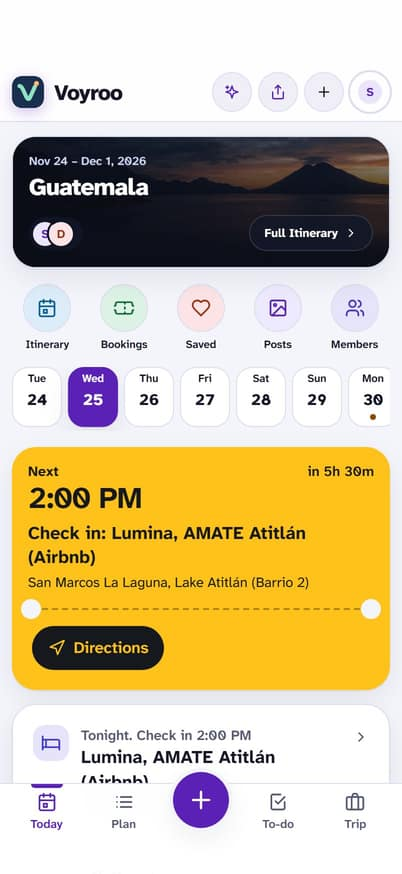 | 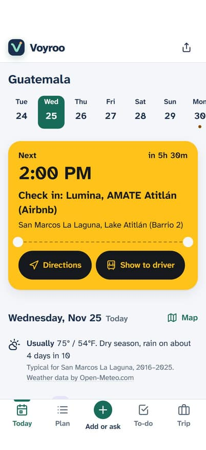 | 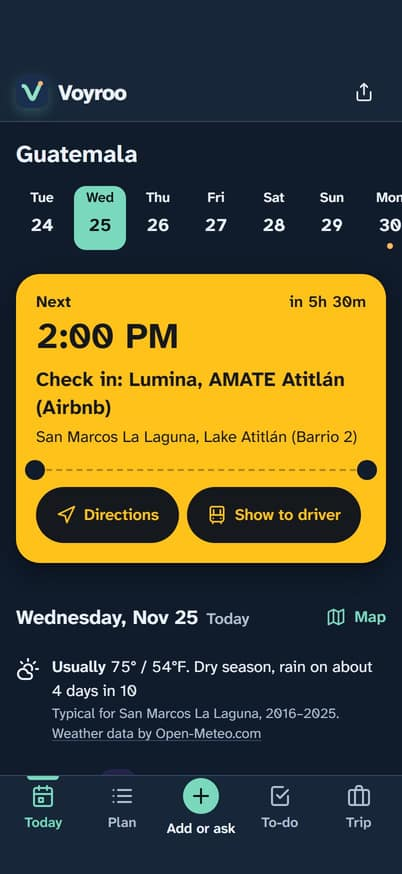 | 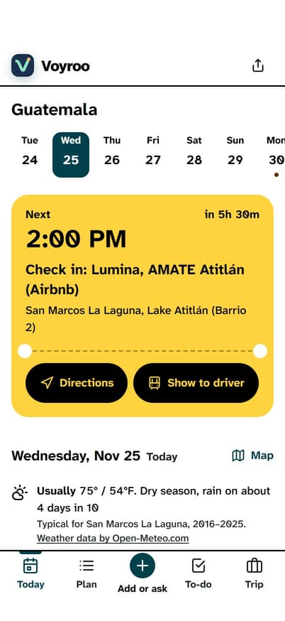 |

**Plan**, first screen. Before: hero, circles with counts, a carousel. After: Days · Map · Ideas · Posts, then the first day.

| Before | After (light) | After (dark) | After (Sunlight) |
|---|---|---|---|
| 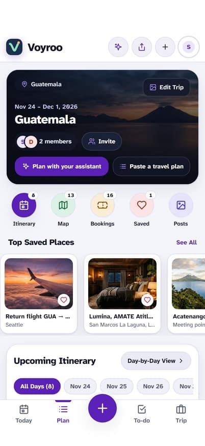 | 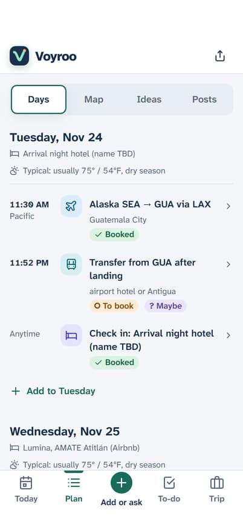 | 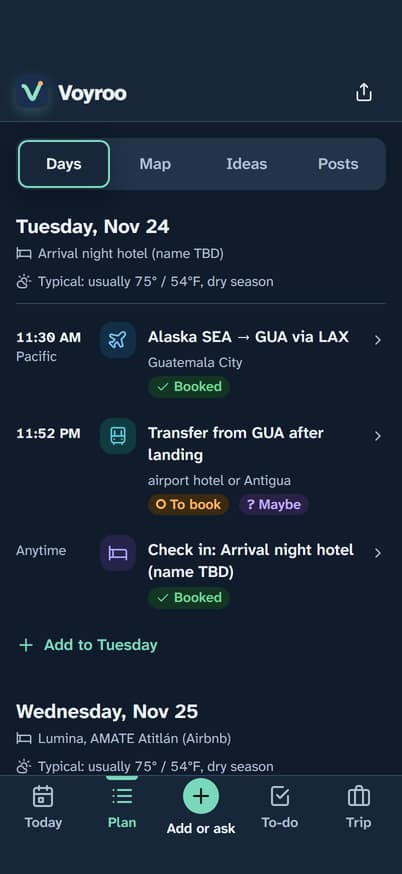 | 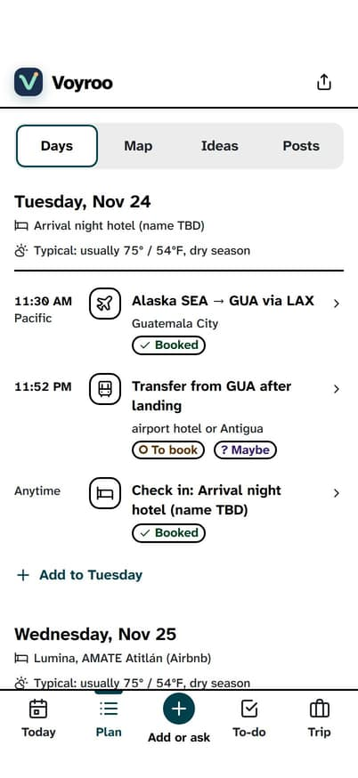 |

**Plan › Map** (Today's "Map" opens it on that day) and **Ideas** with votes in words.

| Map (light) | Map (dark) | Map (Sunlight) | Ideas before | Ideas after | Ideas after (Sunlight) |
|---|---|---|---|---|---|
| 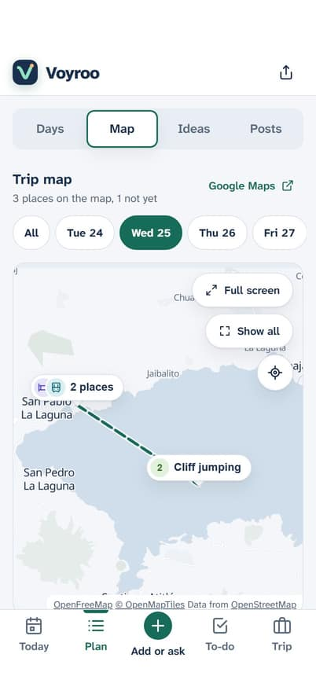 | 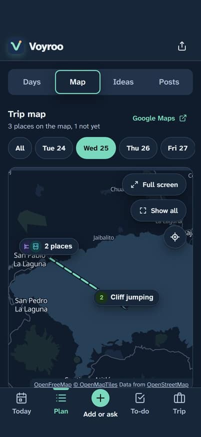 | 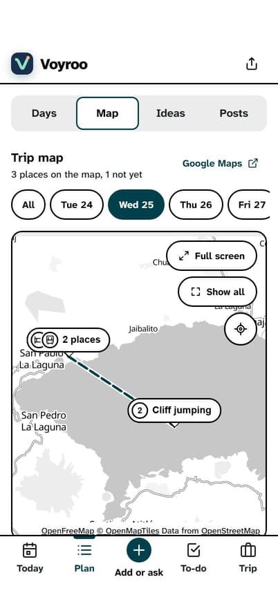 | 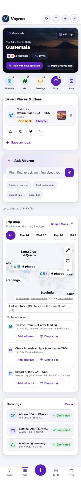 | 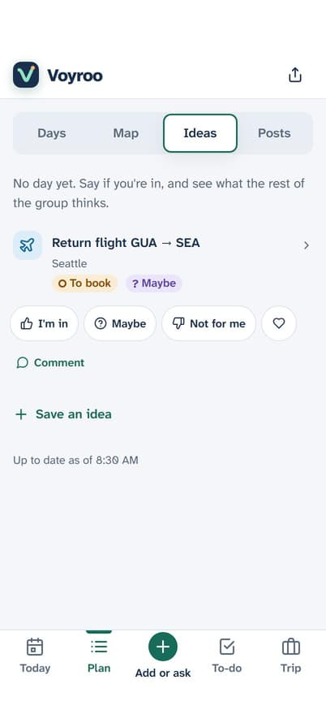 | 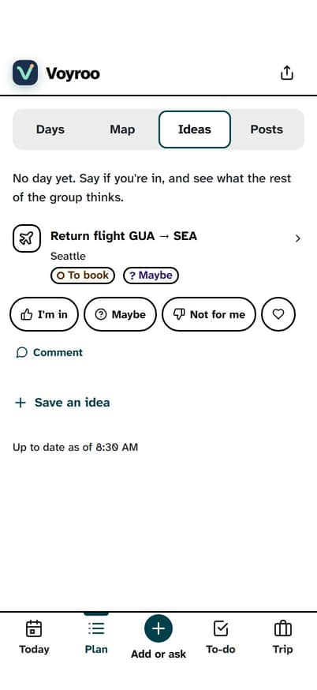 |

**Item page**: actions in words and wrapping, Mark as booked for things to book, Show to driver, the signpost to votes and comments.

| Before (first screen) | After (first screen) | After, a booked stay (whole page) | After, iPhone SE |
|---|---|---|---|
| 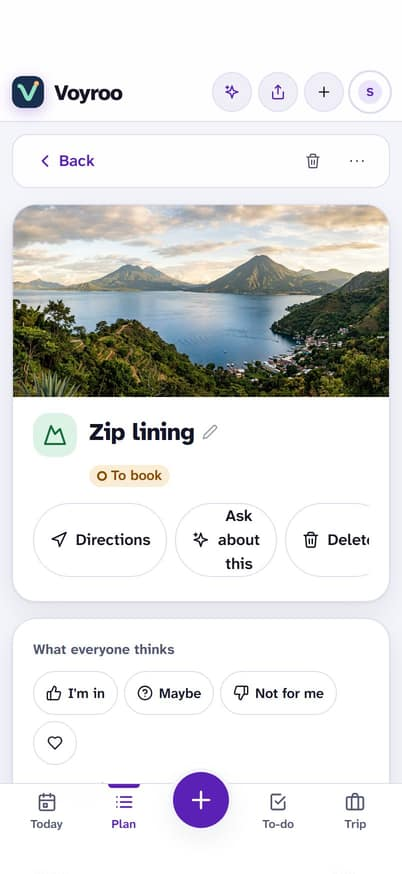 | 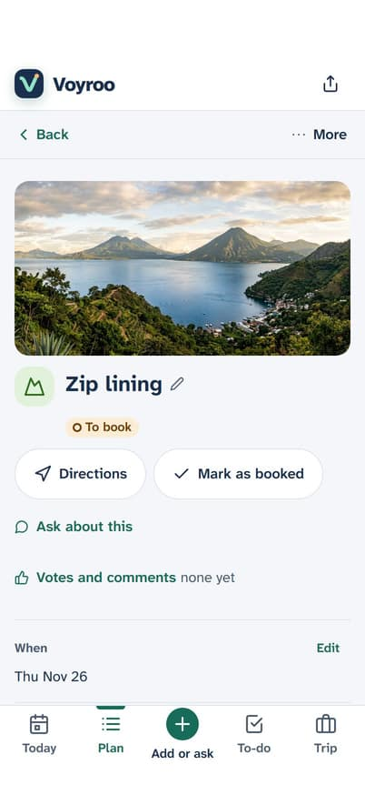 | 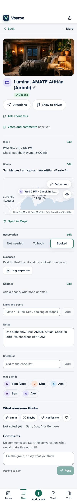 | 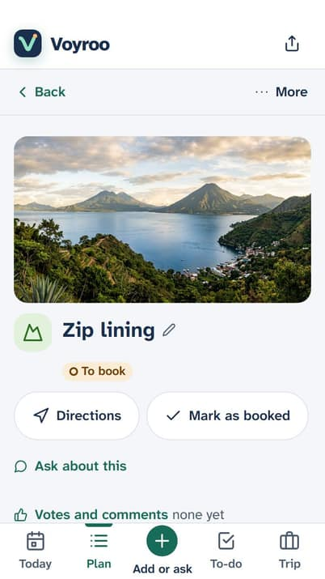 |

**To-do · Packing · Expenses**.

| To-do before | To-do after | Packing after | Expenses after (light) | Expenses after (dark) |
|---|---|---|---|---|
| 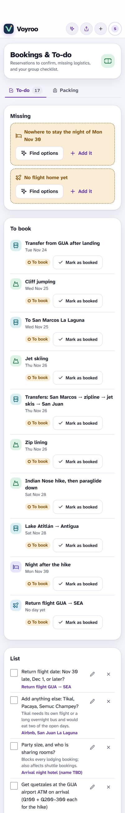 | 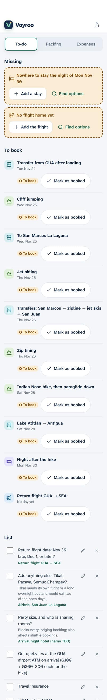 | 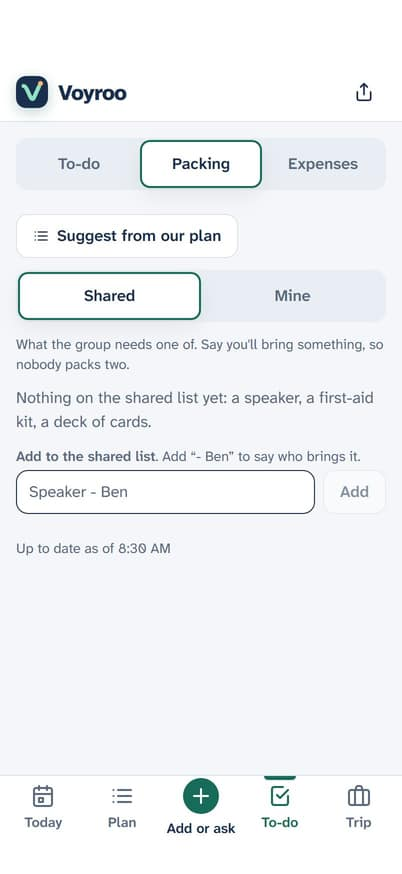 | 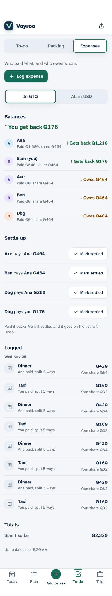 | 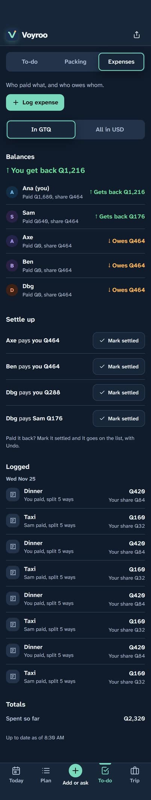 |

**Trip, the driver card, the + sheet, the assistant, offline**.

| Trip before | Trip after | Show to driver | + Add or ask | Assistant | Offline | Today on an SE |
|---|---|---|---|---|---|---|
| 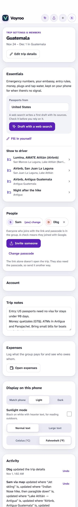 | 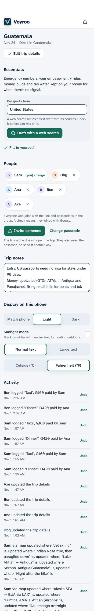 | 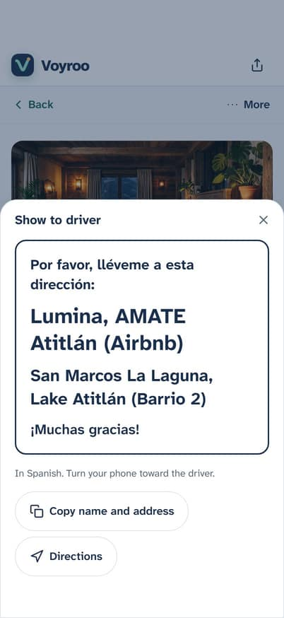 | 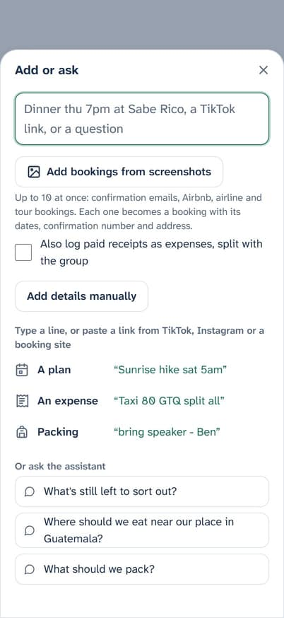 | 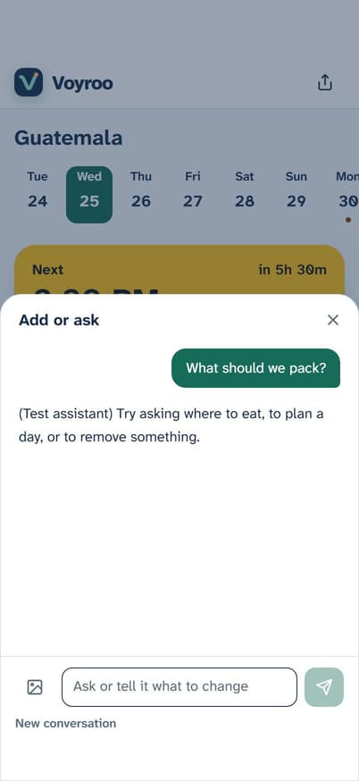 | 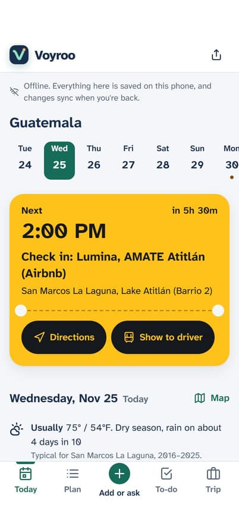 | 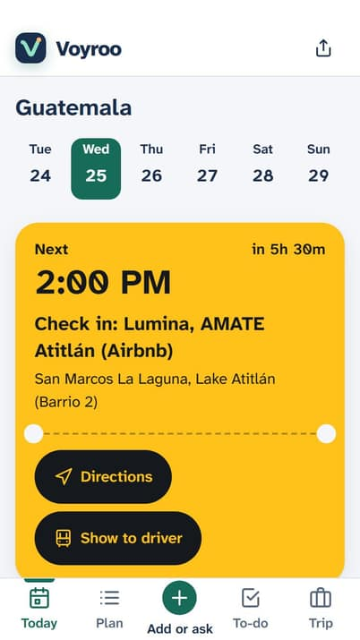 |

Whole-page before shots of Today and Plan: [Today](audit-2026-11/before/01-today-light.jpg), [Plan](audit-2026-11/before/02-plan-light.jpg). After: [Today](audit-2026-11/after/01-today-light.jpg), [Plan](audit-2026-11/after/02-plan-light.jpg).

## Open questions for the owner

1. **Expenses under To-do.** This branch puts Expenses as the third part of the To-do tab, next to Packing, because the bar has four places plus the + and Apple caps tab bars at five. If the group looks for money in Trip first, it can move there instead. Worth a five-minute first-click test: "Where would you see who owes whom?"
2. **Status-bar color on an installed iPhone app.** The app asks for a translucent black status bar (`appleWebApp.statusBarStyle: "black-translucent"`), which draws the clock in white. Now that the app follows the phone's light mode, check on a real iPhone that the clock and battery stay readable over the light header; if not, switch to `"default"`.
3. **Photos on rows.** Rows now show a picture only when someone attached one (a post or a link's image). The item page still shows the looked-up photo. Say if you'd rather have photos on every row.
4. **"Maybe" twice.** An item can be marked "? Maybe" (the plan is tentative), and people vote "Maybe" (they might join). The critic flagged the two meanings side by side on an idea. Renaming one (say, "Not sure" for the vote) touches stored words and the assistant, so it's left for you to decide.
5. **A list of every booking with its code.** The old Plan dashboard's Bookings card (three items, "Confirmed", no codes) is gone; codes are on each item, on the ticket and on Tonight. If the group wants one list of confirmations to show at desks, it would belong under To-do.
6. **Human test.** Hand a phone to two or three trip-mates for five minutes, one-handed, and ask them to find tonight's address for a driver, who owes whom, and the trip map.

## Follow-ups (not in this branch)

- The home page and All trips still use the old dark cards with raw hex (`features/home/Home.tsx:47–59`) and show each trip twice on phones.
- The view-only shared page (`/p/…`) was drawn for the old dark theme; its status badges now use the status tokens, but the rest deserves a light-theme pass.
- Body text is 16px (Tailwind `text-base`); the skill asks for 17px. A type-scale change touches every screen.
- The bottom bar pads itself with `env(safe-area-inset-bottom)`; `platform.md` recommends Chrome's `safe-area-max-inset-bottom` pattern.
- Offline is detected from `navigator.onLine`; the platform notes recommend detecting it from failed requests.
